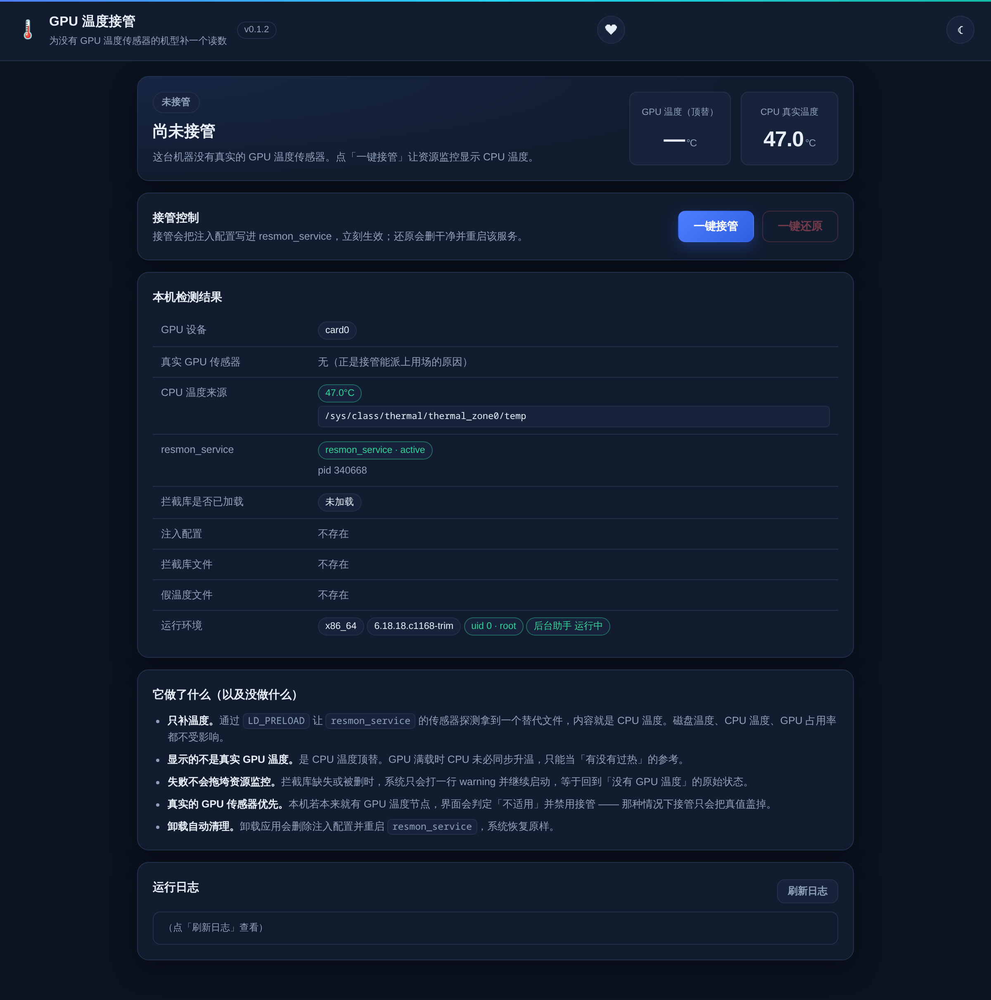
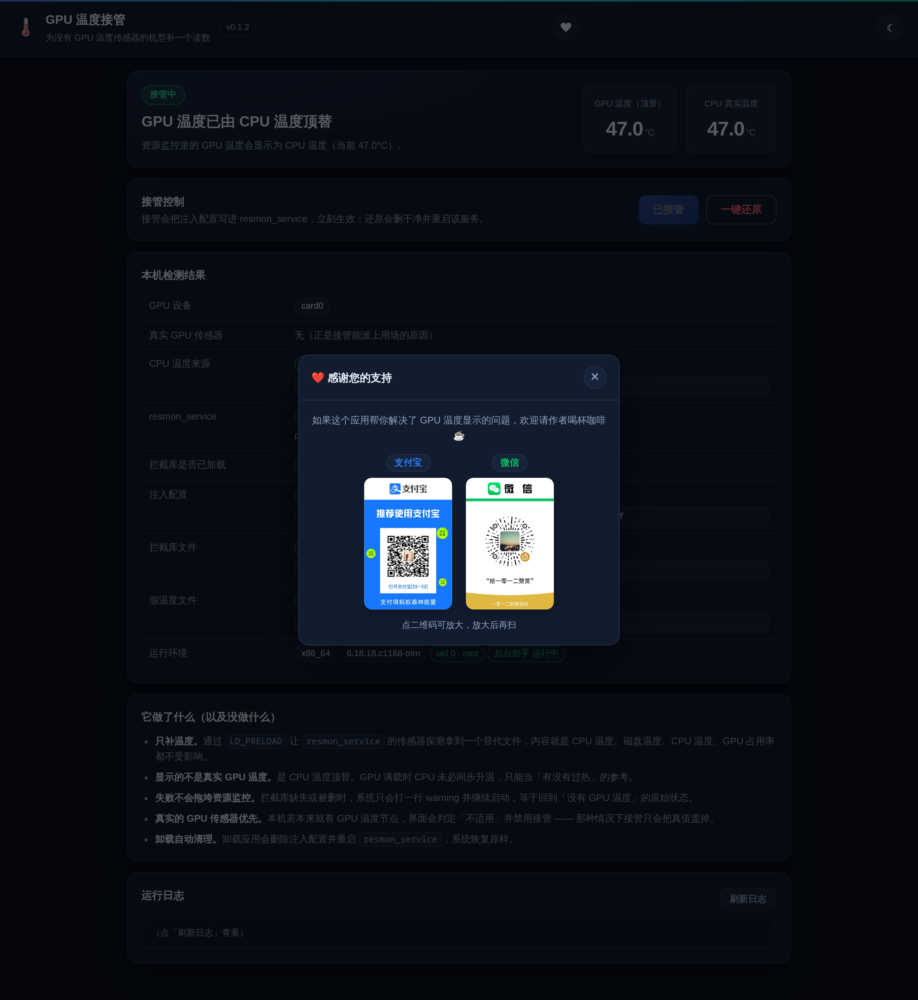

# GPU 温度接管

给**内核层就没有 GPU 温度传感器**的机型补一个读数，让 fnOS「资源监控」里的「GPU 温度」不再空白。


## 适用机型

典型的是 Intel Celeron J3355（Apollo Lake）这类 i915 核显机器：
CPU 温度齐全（`coretemp` / `acpitz` / `x86_pkg_temp`），但 GPU 温度节点在
`/sys/class/drm/card0/device/hwmon` 下**根本不存在** —— 不是驱动没装，是内核层面就不导出。

如果你的机器本来就能看到 GPU 温度，本应用会判定「**不适用**」并禁用接管 —— 那种情况下接管只会把真值盖掉。

## 功能

- **一键接管 / 一键还原**：注入配置、重启服务、撤销清理，都在界面上点一下
- **接管前先验证**：写完配置后会检查拦截库是否**真的加载进 resmon 进程**，不只是看命令返回码
- **本机检测表**：GPU 设备、真实传感器、CPU 温度来源、服务状态、库是否加载、配置与文件路径一目了然
- **适用性判定**：检测到真实 GPU 传感器 / 读不到 CPU 温度 / 架构无对应库时，直接禁用按钮并说明原因
- **卸载自动清理**：卸载应用会删掉注入配置并重启服务，不留悬挂的 `LD_PRELOAD`
- **深色 / 浅色主题 + 手机端适配**



## 原理

fnOS 的 `resmon_service` 通过 `libhwinfo.so` 用 `glob()` 探测传感器，GPU 温度走：

```
/sys/class/drm/card0/device/hwmon/hwmon*/temp*_input
```

本应用把一个约 20KB 的拦截库通过 `LD_PRELOAD` 注入 `resmon_service`：

| 拦截 | 行为 |
|---|---|
| `glob()` / `glob64()` | 只对「GPU 设备 + hwmon + temp」的 pattern 生效；真实匹配 0 个时补一个替代文件，其它 pattern 原样透传 |
| `open()` / `open64()` / `fopen()` | 打开替代文件前先写入当前 CPU 温度 |
| `read()` / `pread64()` / `close()` | 跟踪 fd，上层缓存了 fd 也在读之前补刷（200ms 节流） |

替代文件的内容就是 CPU 温度。

## 会不会影响系统

| 动作 | 影响 |
|---|---|
| 装应用 | 一个 nologin 用户 + 约 280KB 目录；不监听端口、不装内核模块、不改启动项、不联网 |
| 一键接管 | 新增 **1 个** systemd drop-in + 重启 `resmon_service`（1~2 秒，只影响资源监控页） |
| 一键还原 | 删掉那个 drop-in + 重启服务，恢复原样 |
| 注入失败 | glibc 只打一行 warning 继续启动 —— 最坏结果是「GPU 温度回到空白」，不会把资源监控搞挂 |

存储、共享、Docker、相册、媒体库等其它服务都不受影响。

## 使用

1. 应用中心安装
2. 打开应用 → 自动检测本机情况
3. 点「一键接管」→ 打开 fnOS「资源监控」，GPU 温度会显示与 CPU 接近的数值
4. 想撤销就点「一键还原」（**需要点两次**，第一次会提示确认）

## 注意

- **显示的不是真实 GPU 温度**，是 CPU 温度顶替。GPU 满载时 CPU 未必同步升温，只能当「有没有过热」的参考
- 只补温度。GPU 占用率、频率本来就能读到，不受影响
- fnOS 若升级后改用别的传感器枚举方式，注入会**静默失效**（无害，GPU 温度重新变空白），重新点一次接管或等应用更新即可
- 应用需要 root 权限才能写 `/etc/systemd` 并重启系统服务



## 版本历史

### v0.1.2 (2026-10-29)

- 修「一键还原」点了没反应：不再假设 CGI 以 root 运行（新增 root 后台助手兜底），
  变更接口改为 token 校验，还原的两次确认补了提示，每次请求写入 requests.log
- 修手机端状态卡片一大块空白（`flex-basis` 在纵向布局下变成高度基准）与两个温度块错位
- 明细表长路径不再拦腰断字（单行 + 单元格内横向滑动 + 超出渐隐）
- 头部新增赞助按钮

### v0.1.1 (2026-10-29)

- 修 CPU 温度来源显示为空
- 只带 `wizard/uninstall`，避开 fnOS 的 wizard 校验错误

### v0.1.0 (2026-10-29)

- 首个版本：LD_PRELOAD 注入 `resmon_service`，用 CPU 温度顶替 GPU 温度
- 双架构拦截库（x86_64 / aarch64）、纯 bash CGI 零运行时依赖
