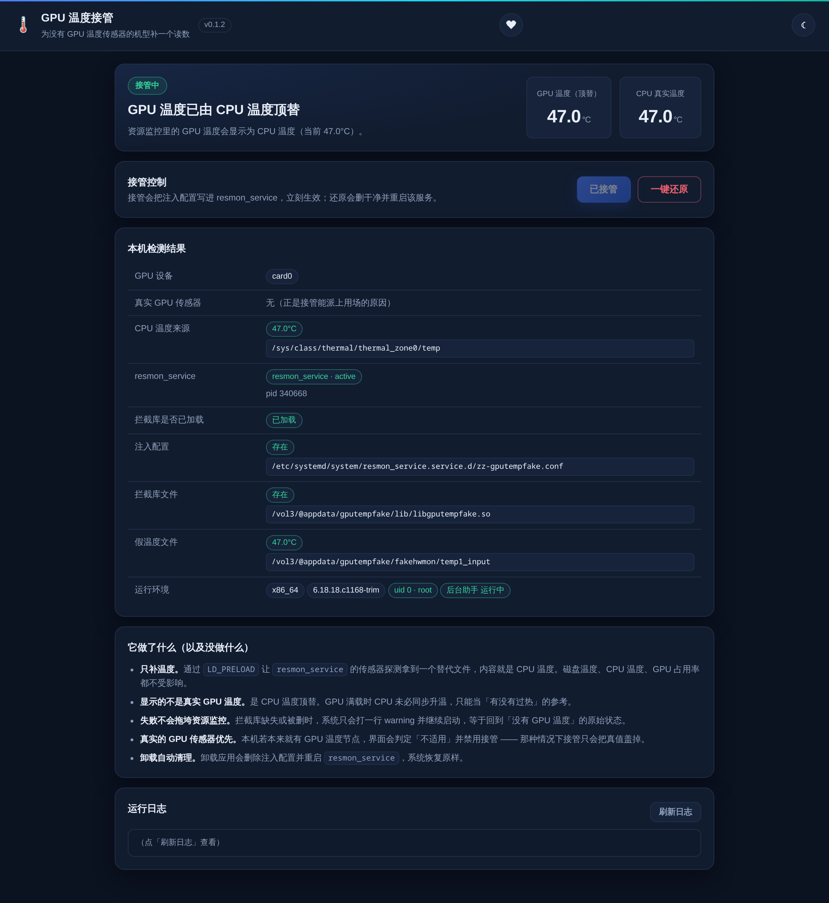

# GPU 温度接管（GPUTempFake）

给**内核层就没有 GPU 温度传感器**的机型补一个读数，让 fnOS「资源监控」里的「GPU 温度」不再空白。

> 典型机型：Intel Celeron J3355（Apollo Lake）这类 i915 核显。
> 这类机器 CPU 温度齐全（`coretemp` / `acpitz` / `x86_pkg_temp`），
> 但 `/sys/class/drm/card0/device/hwmon` 下**根本没有温度节点** ——
> 不是驱动没装，是内核层面就不导出。



## 它到底做了什么

fnOS 的 `resmon_service` 通过 `libhwinfo.so` 用 `glob()` 探测传感器，GPU 温度走的是：

```
/sys/class/drm/card0/device/hwmon/hwmon*/temp*_input
```

本应用把一个 20KB 的拦截库 `libgputempfake.so` 通过 `LD_PRELOAD` 注入 `resmon_service`，拦截三组函数：

| 拦截 | 行为 |
|---|---|
| `glob()` / `glob64()` | **只**对「GPU 设备 + hwmon + temp」这种 pattern 生效；真实匹配 0 个时，返回一个替代文件把结果补上。其它 pattern 全部原样透传 |
| `open()` / `open64()` / `fopen()` | 打开替代文件前，先把当前 CPU 温度（毫摄氏度）写进去 |
| `read()` / `pread64()` / `close()` | 跟踪替代文件的 fd —— 万一上层缓存了 fd、不再重新 open，也在读之前补一次刷新（200ms 节流） |

替代文件的内容 = **CPU 温度**，所以资源监控里显示的是「用 CPU 温度顶替的 GPU 温度」。

## 一句话：会不会影响系统

| 动作 | 影响 |
|---|---|
| **装 fpk** | 一个 nologin 系统用户 + 约 280KB 目录。不监听端口、不装内核模块、不改启动项、不联网 |
| **点「一键接管」** | 新增 **1 个** systemd drop-in 文件 + `systemctl restart resmon_service`（1~2 秒，只影响资源监控页） |
| **点「一键还原」** | 删掉那个 drop-in + 重启服务，恢复原样 |
| **卸载应用** | 自动撤掉注入并重启服务，不留悬挂的 `LD_PRELOAD` |
| **注入失败** | glibc 只打一行 warning 继续启动 —— 失败模式是「GPU 温度回到空白」，**不会**把资源监控搞挂 |

存储、共享、Docker、相册、媒体库等其它服务都不受影响（不碰内核、不碰驱动、不碰网络）。

## 安全边界

- **取不到 CPU 温度就不注入**：宁可保持空白，也不给一个假数字
- **真实传感器优先**：本机若已经有 GPU 温度节点，界面判定「不适用」并禁用按钮 —— 那种情况下接管只会把真值盖掉
- **写入范围只有一处**：`/etc/systemd/system/resmon_service.service.d/zz-gputempfake.conf`
- **还原是真删**：删除 drop-in → `daemon-reload` → 重启服务 → 删库和替代文件，并**核验库是否真从进程内存消失**（不是只看命令返回码）
- **变更接口要 token**：`/api/status` 下发随机 token，`install`/`uninstall` 必须带 token + POST，防跨站触发
- **root 动作有兜底通道**：CGI 若被降权运行，动作转由 `cmd/main` 以 root 拉起的 `rootd.sh` 执行，只认 `install` / `uninstall` 两个固定动作，不接受任意命令

## 安装与使用

1. 应用中心安装 `gputempfake.fpk`（自带 x86_64 / aarch64 两个库，按架构自动选）
2. 打开应用 → 自动检测本机情况，顶部显示「接管中 / 未接管 / 不适用」+ 原因
3. 点「**一键接管**」→ 写注入配置、重启 `resmon_service`，并**验证库是否真的加载进进程**
4. 打开 fnOS「资源监控」→ GPU 温度会显示与 CPU 接近的数值
5. 想撤销：点「**一键还原**」（**需要点两次**，第一次会提示确认）

界面里还有一个「本机检测结果」表：GPU 设备、真实传感器、CPU 温度来源、服务状态、库是否加载、注入配置与文件路径 —— 出问题先看这张表。

## 目录与文件

| 路径 | 作用 |
|---|---|
| `<PKGVAR>/lib/libgputempfake.so` | 拦截库（安装时按架构从包内选） |
| `<PKGVAR>/fakehwmon/temp1_input` | 替代温度文件（内容实时刷新） |
| `<PKGVAR>/log/app.log` | 接管/还原记录 |
| `<PKGVAR>/log/requests.log` | 每次 Web 请求留痕（uid / 方法 / token 有无），排查「点了没反应」用 |
| `<PKGVAR>/log/rootd.log` | root 后台助手的执行记录 |
| `<PKGVAR>/log/trace.log` | 拦截库调试 trace（默认关闭） |
| `/etc/systemd/system/resmon_service.service.d/zz-gputempfake.conf` | **唯一一处系统改动** |

`<PKGVAR>` 默认 `/vol3/@appdata/gputempfake`。日志都有 256KB 上限，不会无限长。

## 已知限制

- **显示的不是真实 GPU 温度**：GPU 满载时 CPU 未必同步升温，只能当「有没有过热」的参考
- **只补温度**：GPU 占用率、频率本来就能读到，不受影响
- **依赖 `resmon_service` 的探测方式**：fnOS 若改成不用 `glob()` 枚举传感器，注入会静默失效（无害，但会显示空白）。届时改钩子即可
- **需要 root**：应用用 `run-as=root` 才能写 `/etc/systemd` 并重启系统服务。自己分发没问题，提交官方应用中心可能被拒
- **arm64 只能保证编得出来**：交叉编译通过、能正常加载，但没有 ARM 真机验证过

## 常见问题

**Q：点「一键还原」没反应？**
需要点两次（防误触），第一次点会有提示「再点一次按钮确认还原（6 秒内有效）」。如果两次都没反应，去 `<PKGVAR>/log/requests.log` 看请求有没有到、`uid` 是多少。

**Q：卸载后想彻底清干净？**
fnOS 卸载应用通常不删对应的系统用户。需要的话手动执行 `sudo userdel -r gputempfake`。

**Q：重装新版本没生效？**
fnOS 对已安装应用执行 `install-fpk` **不会替换** target 下的文件。请在 Web UI 里先卸载，再装新的 fpk。

**Q：接管后 GPU 温度一直不变？**
资源监控是按需读取的 —— 打开那个页面时才会去读传感器。不打开时替代文件的 mtime 不动，属正常。

## 从源码构建

```bash
bash src/build-shim.sh      # 编 x86_64 + aarch64 拦截库
                            # 交叉工具链：apt install gcc-aarch64-linux-gnu
python3 src/make-icons.py   # 重新生成图标
fnpack build .              # 产物 gputempfake.fpk（manifest 所在目录执行）
```

## 版本历史

### v0.1.0 (2026-10-29)

首个公开版本。

- **原理**：LD_PRELOAD 注入 `resmon_service`，拦截 `glob` / `open` / `read` 三组函数，
  真实 GPU 温度节点不存在时用 CPU 温度顶替
- **一键接管 / 一键还原**：写入 systemd drop-in 并重启服务；还原会删干净、重启服务，
  并核验库是否真的从进程内存消失
- **root 兜底通道**：CGI 被降权运行时，动作转由 `cmd/main` 以 root 拉起的 `rootd.sh` 执行，
  只认 `install` / `uninstall` 两个固定动作
- **防跨站**：`/api/status` 下发随机 token，变更接口必须带 token + POST
- **适用性判定**：真实 GPU 传感器 / 读不到 CPU 温度 / 架构无对应库 → 判定「不适用」并禁用按钮
- **本机检测表**：GPU 设备、真实传感器、CPU 温度来源、服务状态、库是否加载、配置与文件路径
- **安装统计**：普通机器每次安装、每次升级各上报一条；
  本开发机带去重开关（标记文件 `dev-dedupe` 或环境变量 `GPUTEMPFAKE_DEV_DEDUPE=1`），
  开发调试时反复装卸不会刷量。推送失败不记账，下次可重试
- 双架构拦截库（x86_64 / aarch64）、纯 bash CGI 零运行时依赖
- 深色 / 浅色主题，手机端适配；头部赞助按钮，赞赏码可点开放大
- 卸载自动撤销注入，不留悬挂的 `LD_PRELOAD`
